# FitTrack - DBMS Level 3 Project Report

**Course:** DBMS Experiential Learning - Level 3 · **Department:** Computer Science and Engineering
**Repository:** https://github.com/duplicatenode/Fitness-Tracker

---

## 1. Objectives

1. Track a person's training end to end: workout plans, the sessions they actually do, the sets inside each session, and goals.
2. Capture a continuous stream of wearable data (heart rate, steps, calories, activity state) next to the workout records.
3. Enforce fitness rules **inside the database**, not only in the app: finished workouts are locked, and weekly goals complete automatically.
4. Use each database for the data it suits best: **MySQL** for related, transactional records and **Memurai (Redis)** for high-volume, append-only or loosely structured data.
5. Provide a **Next.js** web interface with authentication and two roles (**admin**, **member**), enforced in the API and in the database.

## 2. Functional requirements

| ID | Requirement | Where it is implemented |
|---|---|---|
| FR1 | A visitor can create an account (name, email, password, optional profile) and sign in. Passwords are stored as bcrypt hashes. | `POST /auth/register`, `/auth/login`; `users`, `user_profiles` (one transaction) |
| FR2 | A signed-in user can view and edit their profile and change their password. | `/auth/me`, `/auth/password`; Profile page |
| FR3 | A member can create, view, edit and delete workout plans made of exercises from a shared catalogue. | `workout_plans`, `plan_exercises`, `exercises`; Workout Plans page |
| FR4 | A member can start a session from a plan, log sets, and finish the session. A finished session accepts no more sets. | `workout_sessions`, `workout_sets`; trigger `trg_sets_locked_session` |
| FR5 | A member can set goals (weekly workouts, daily steps, daily calories) and see progress. A weekly goal is marked completed automatically when its target is reached. | `fitness_goals`; trigger `trg_session_finished` |
| FR6 | A member can write, search, edit and delete journal entries with mood and tags. | Memurai `fittrack:journal:{userId}:{id}` |
| FR7 | Wearable readings are recorded every 5 seconds and shown as live status, charts and daily totals. | Memurai stream `fittrack:sensors:{userId}`, hash `fittrack:activity:daily:{userId}:{date}` |
| FR8 | A member can keep a progress gallery (photo metadata). | Memurai `fittrack:photos:{userId}:{id}` |
| FR9 | An admin can list all users, see activity and audit logs, and change a user's role. The last admin cannot be demoted. | `/admin/*`; procedure `sp_change_role`, `role_audit_log` |
| FR10 | A member cannot reach admin screens or admin API routes, and the member database account cannot read password hashes or change roles. | `requireRole('admin')`; MySQL roles `fittrack_admin`, `fittrack_member` |

## 3. Database design and implementation (where to find each part)

| Brief item | Document / file |
|---|---|
| ER diagram | [`database/docs/er_diagram.png`](../database/docs/er_diagram.png) (source `er_diagram.mmd`) |
| Relational schema and ER-to-table mapping | [`database/docs/RELATIONAL_SCHEMA.md`](../database/docs/RELATIONAL_SCHEMA.md) sections 1-2 |
| Data dictionary and constraints | `RELATIONAL_SCHEMA.md` section 3 |
| Database choice and justification | `RELATIONAL_SCHEMA.md` section 6 |
| NoSQL data model (keys, types, operations) | `RELATIONAL_SCHEMA.md` section 7, [`database/README.md`](../database/README.md) |
| SQL implementation (DDL) | [`database/schema.sql`](../database/schema.sql) - 10 tables, PK/FK, CHECK, UNIQUE, indexes |
| Triggers, procedure, function, views | [`database/programmability.sql`](../database/programmability.sql) |
| Database roles and grants | [`database/security/roles.sql`](../database/security/roles.sql) |
| Important queries | [`database/queries.sql`](../database/queries.sql) - 14 labelled queries |
| Screen-to-table mapping | [`database/docs/UI_TABLE_MAPPING.md`](../database/docs/UI_TABLE_MAPPING.md) |

**Important queries (summary of `queries.sql`):** inner and outer joins, aggregates with `GROUP BY` / `HAVING`,
`NOT IN` and correlated `NOT EXISTS` subqueries, a three-level nested query, a correlated subquery against each user's own
average, a `WITH` CTE leaderboard using `RANK()`, a `WITH RECURSIVE` 7-day calendar, a transaction with `ROLLBACK`,
views, and `EXPLAIN` showing the composite index `idx_user_sessions` in use.

## 4. System architecture

```
 Browser
   |
   v
 Next.js 16 app (frontend/, port 3000)
   - App Router: one route per screen in src/app/
   - (app)/layout.jsx: auth guard + sidebar/header shell
   |
   |  HTTPS/JSON + JWT (Authorization: Bearer ...)
   v
 Express 5 API (backend/, port 5000)
   - authMiddleware (JWT), requireRole('admin') (role read from MySQL on every request)
   - controllers: auth, workouts, goals, journals, photos, activity, dashboard, admin
   |                                   |
   v                                   v
 MySQL 8 (fittrack_db)               Memurai / Redis
   10 tables, 2 triggers,              Stream  fittrack:sensors:{userId}
   1 procedure, 1 function,            Hash    fittrack:activity:daily:{userId}:{date}
   2 views, 2 DB roles                 JSON    fittrack:journal:*, fittrack:photos:*
                                       ^
                                       |
                    Wearable simulator (simulator/) - one reading per user every 5 s
```

All credentials and the JWT secret are read from `.env` (git-ignored). The backend will not start if a required one is missing.

## 5. Application screenshots

| Screen | Screenshot |
|---|---|
| Sign in | 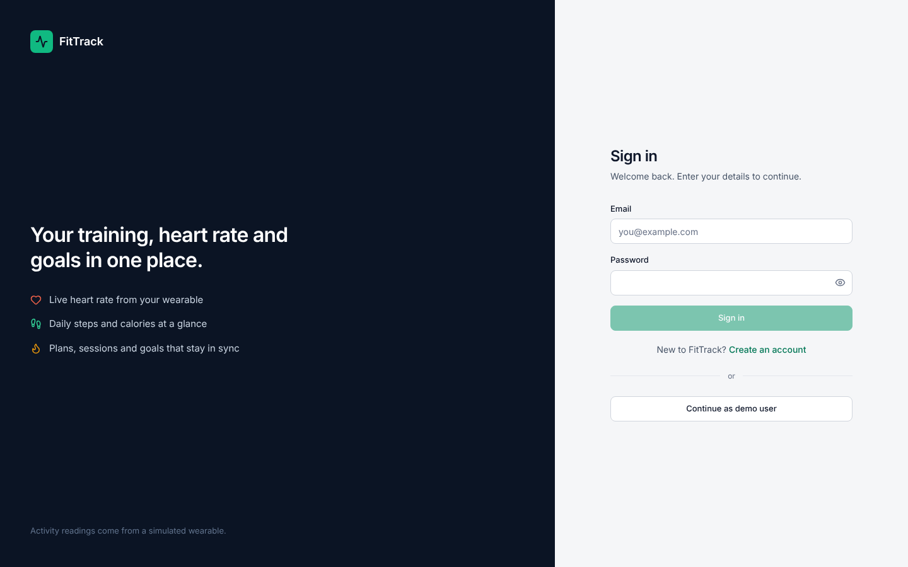 |
| Create account (client-side validation, password checklist) | 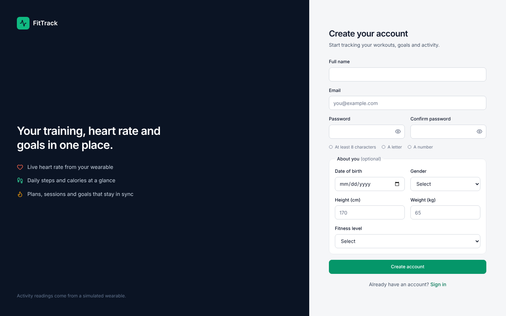 |
| Overview dashboard (MySQL sessions and goals + Memurai live readings) | 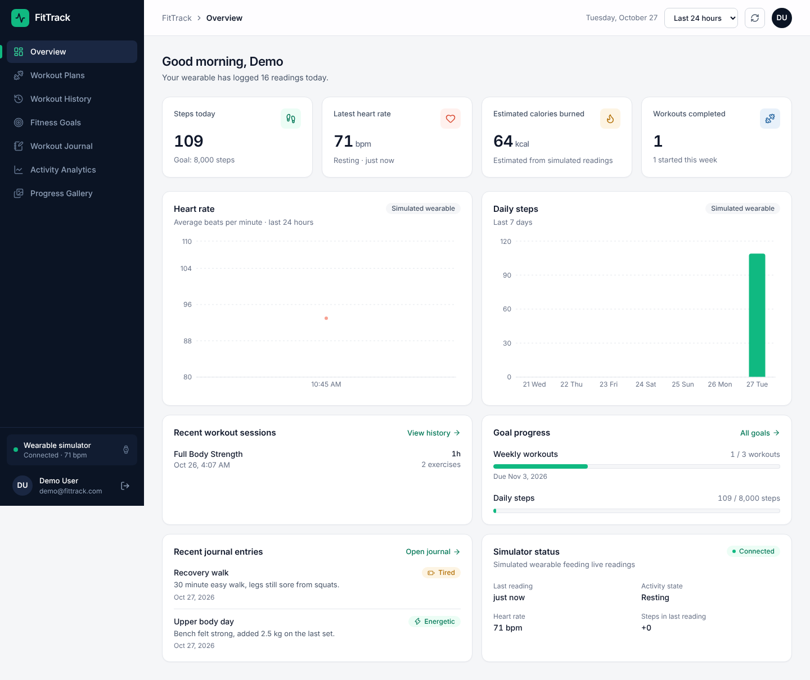 |
| Workout plans | 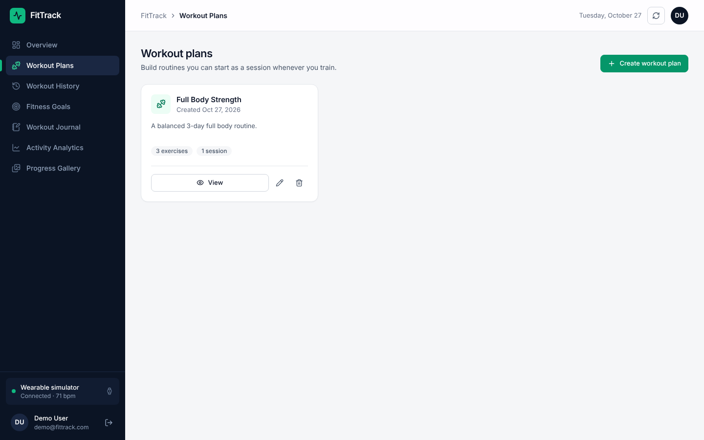 |
| Workout history | 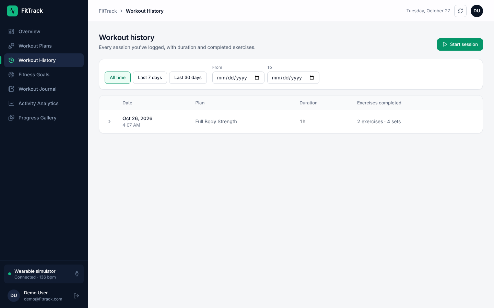 |
| Fitness goals | 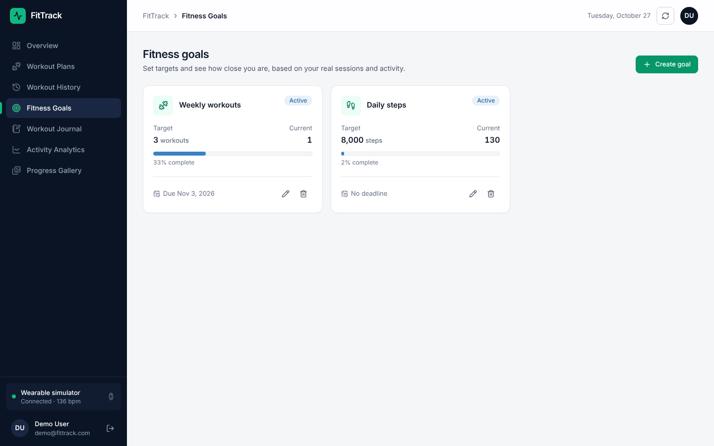 |
| Workout journal (Memurai) | 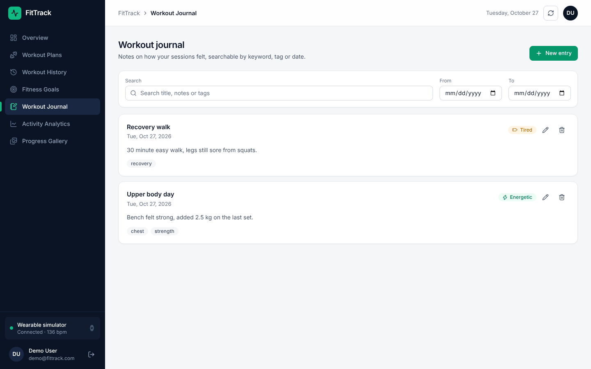 |
| Activity analytics (Memurai stream) | 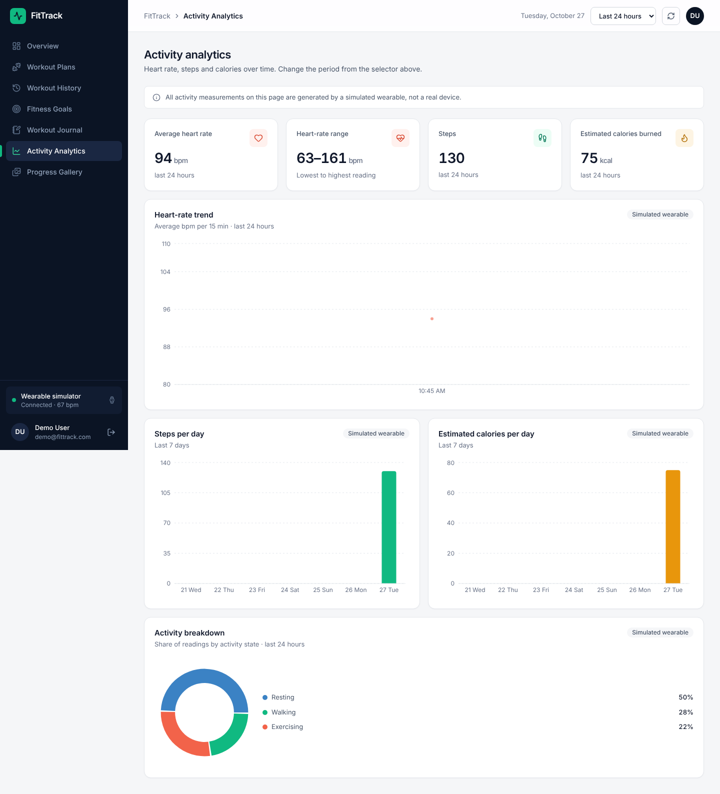 |
| Progress gallery | 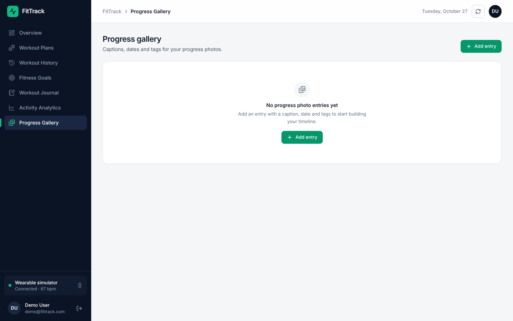 |
| My profile | 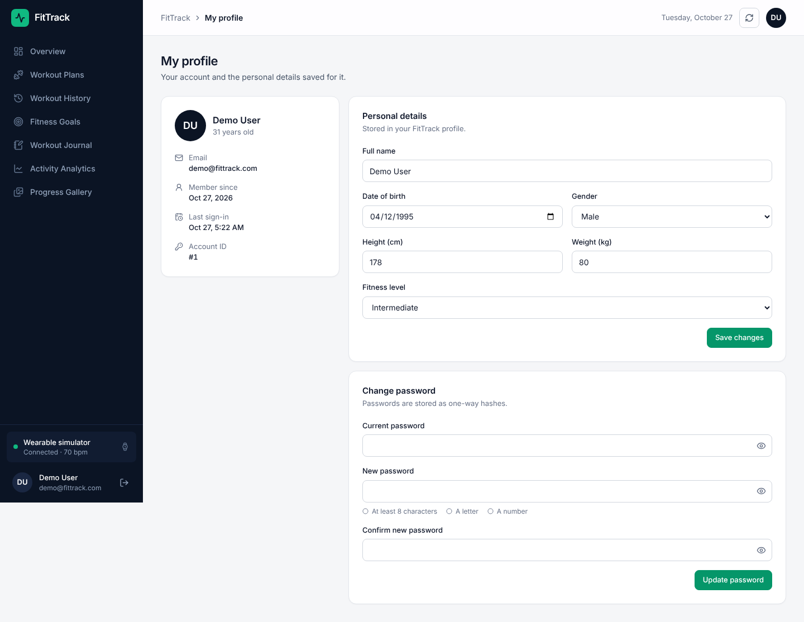 |
| Users & roles (admin only: role change, activity log, audit log) | 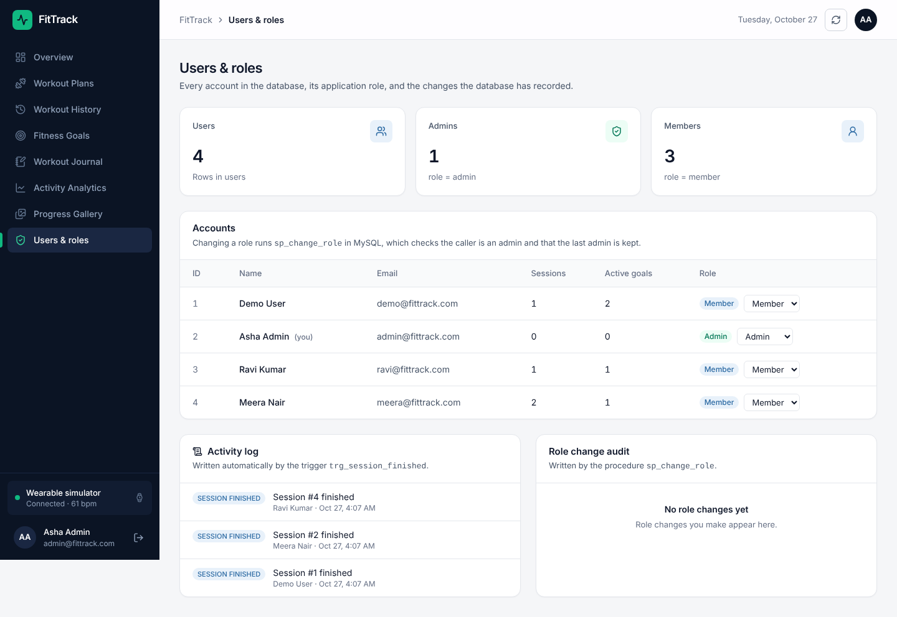 |
| Mobile layout | 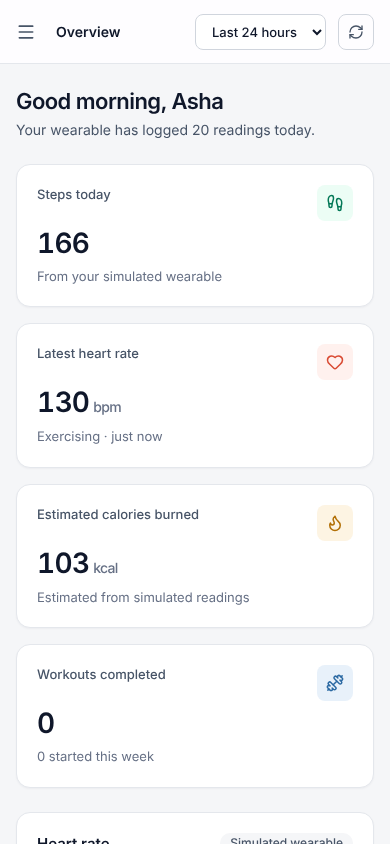 |

## 6. Testing results

**Environment for the recorded run:** Node 22, MariaDB 10.11 (MySQL-compatible), Redis 7.0, database built from scratch with
`node database/setup_mysql.js`, seed data from `database/seed.sql`.
<!-- Re-run on your own machine (MySQL 8 + Memurai) before the demo and update this line if anything differs. -->

### 6.1 Database integrity and stored programs

| # | Test | Expected | Actual | Result |
|---|---|---|---|---|
| T1 | Insert a plan exercise with `reps = 0` | Rejected by `chk_pe_reps` | `ERROR 4025: CONSTRAINT chk_pe_reps failed` | Pass |
| T2 | Set a profile height of 10 cm | Rejected by `chk_profile_height` | `CONSTRAINT chk_profile_height failed` | Pass |
| T3 | Insert a second user with an existing email | Rejected by `UNIQUE(email)` | `ERROR 1062: Duplicate entry` | Pass |
| T4 | Delete an exercise that is used in a plan | Blocked by `ON DELETE RESTRICT` | `ERROR 1451: foreign key constraint fails` | Pass |
| T5 | Goal whose deadline is before its start date | Rejected by `chk_goal_dates` | `CONSTRAINT chk_goal_dates failed` | Pass |
| T6 | Delete a user that has a profile | Profile removed by `ON DELETE CASCADE` | 0 profile rows left | Pass |
| T7 | Finish Meera's open session (weekly goal target 2) | Trigger marks goal `completed`, writes `SESSION_FINISHED` and `GOAL_COMPLETED` to `activity_log` | Goal `active` → `completed`; both log rows written | Pass |
| T8 | Insert a set into the finished session | Refused by `trg_sets_locked_session` | `ERROR 1644: Session is already finished - sets can no longer be logged` | Pass |
| T9 | `fn_session_volume(1)` | 3680 kg | `3680.00` | Pass |
| T10 | `sp_change_role`: promote and revert a member, then demote the last admin | First two succeed and are audited; last is refused | Role changed twice, 2 audit rows; `Cannot demote the last remaining admin` | Pass |
| T11 | Three-level nested query (demo 07) | Demo User, 3680 kg | `1  Demo User  3680.00` | Pass |
| T12 | Insert, update and delete on all 10 tables (demo 03) | All succeed, nothing left behind | `rows left for id 900: 0` | Pass |
| T13 | 7 forbidden actions as `ft_member` (read `users` / `password_hash` / audit log, delete exercise, change role, call procedure, `DROP TABLE`) | All denied | 7 of 7 `command denied` | Pass |
| T14 | `EXPLAIN` on a user's sessions in the last 30 days | Uses `idx_user_sessions` | `key = idx_user_sessions` | Pass |
| T15 | Memurai create / read / update / delete (demo 08) | All commands succeed; deleted key returns nil | Journal, hash and stream created, read, updated (`SET ... XX`, `HINCRBY`), deleted | Pass |

### 6.2 API, authentication and authorization

| # | Test | Expected | Actual | Result |
|---|---|---|---|---|
| A1 | Register a new user | 201 + token | `201 User registered successfully` | Pass |
| A2 | Register the same email again (different case) | 400 | `400 User already exists` | Pass |
| A3 | Register with password `short` | 400 | `400 Password must be at least 8 characters.` | Pass |
| A4 | Register with email `not-an-email` | 400 | `400 Enter a valid email address.` | Pass |
| A5 | Sign in with a wrong password | 401 | `401 Invalid credentials` | Pass |
| A6 | Sign in with the email in upper case | 200 | `200 Login successful` | Pass |
| A7 | Call a protected route with no token | 401 | `401 Authorization token required` | Pass |
| A8 | Call a protected route with a forged token | 401 | `401 Invalid or expired token` | Pass |
| A9 | Member calls `GET /admin/users` | 403 | `403 You do not have permission for this action.` | Pass |
| A10 | Admin calls `GET /admin/users` | 200 with role counts | `200` | Pass |
| A11-12 | Admin promotes, then demotes, a member | 200 each | `200 Role updated` (×2) | Pass |
| A13 | Admin demotes themselves (only admin) | 400 from `sp_change_role` | `400 Cannot demote the last remaining admin` | Pass |
| A14 | Member opens another user's plan | Not visible | `404 Plan not found` | Pass |
| A15-18 | Journal create → update → delete → delete again | 201, 200, 200, 404 | `201`, `200`, `200`, `404` | Pass |
| A19 | `GET /health` | Both databases connected | `200 {"mysql":"connected","memurai":"connected"}` | Pass |

### 6.3 User interface (browser, Playwright)

| # | Test | Result |
|---|---|---|
| U1 | Opening `/plans` while signed out redirects to `/login` | Pass |
| U2 | Member signs in and opens all 7 member pages; each shows its heading and title | Pass |
| U3 | Member opening `/admin` is sent back to `/`; the Users & roles link is not shown | Pass |
| U4 | Admin sees Users & roles with all accounts, the activity log and the audit log | Pass |
| U5 | Log out returns to `/login` | Pass |
| U6 | Unknown URL redirects to `/` | Pass |
| U7 | Mobile width: navigation drawer opens, and closes after choosing a page | Pass |
| U8 | No JavaScript errors on any page | Pass |

## 7. Conclusion

FitTrack shows how a relational and a NoSQL database can each be used for what they do best inside one application.
MySQL holds the core records and enforces the important rules itself: foreign keys and `CHECK` constraints reject invalid data,
a trigger locks finished workouts and completes weekly goals, a stored procedure controls role changes with an audit trail,
and two database roles limit what a member account can read or change. Memurai stores the high-frequency wearable stream,
daily totals and flexible journal documents, where fast appends and a loose structure matter more than joins.
The Next.js interface and the Express API connect the two, with JWT authentication and admin/member authorization checked
in the API and again in the database. All the tests above pass.

**Limitations and future work**
- Row ownership (a member editing only their own rows) is enforced by the API; MySQL has no built-in row-level security.
- The wearable is simulated; a real device integration (e.g. Google Fit) could feed the same Memurai stream.
- No email verification, password reset or login rate-limiting yet.
- Weekly-goal completion runs in the database; step and calorie goals are computed by the API from Memurai and could be moved to a scheduled job.
